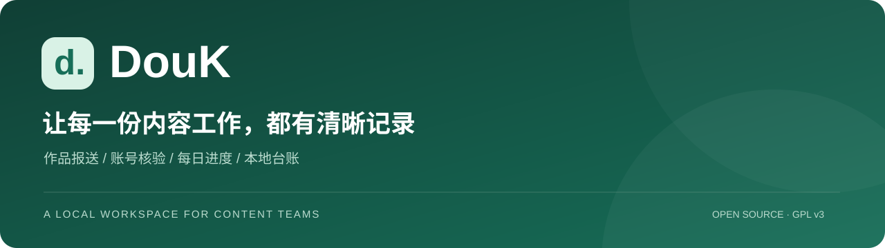
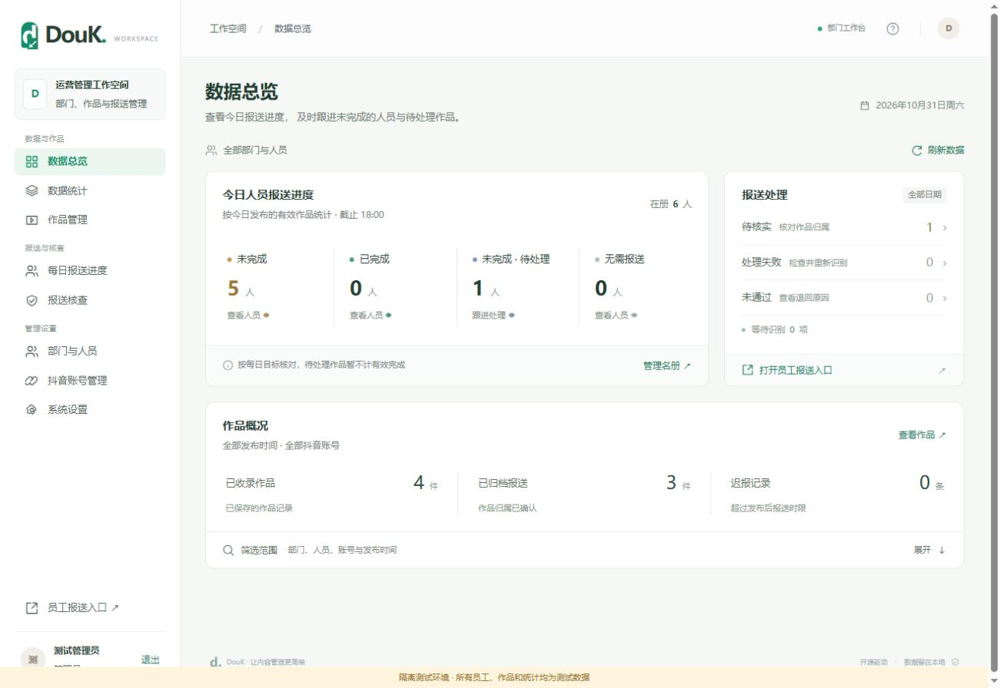
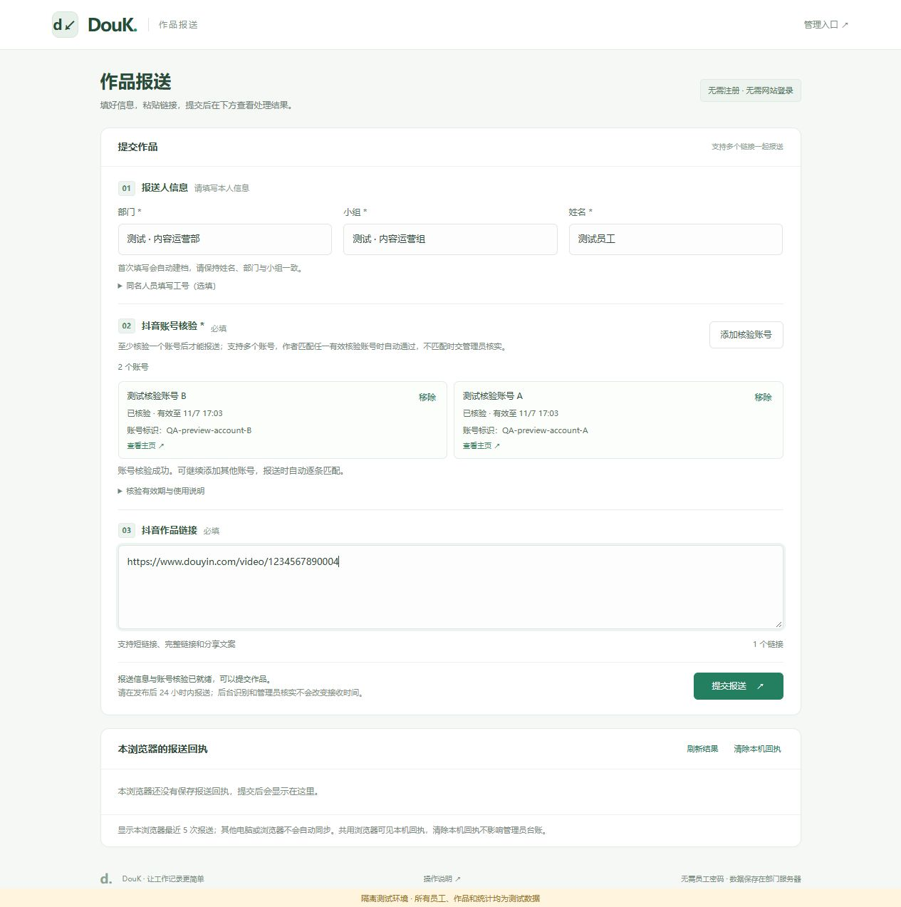
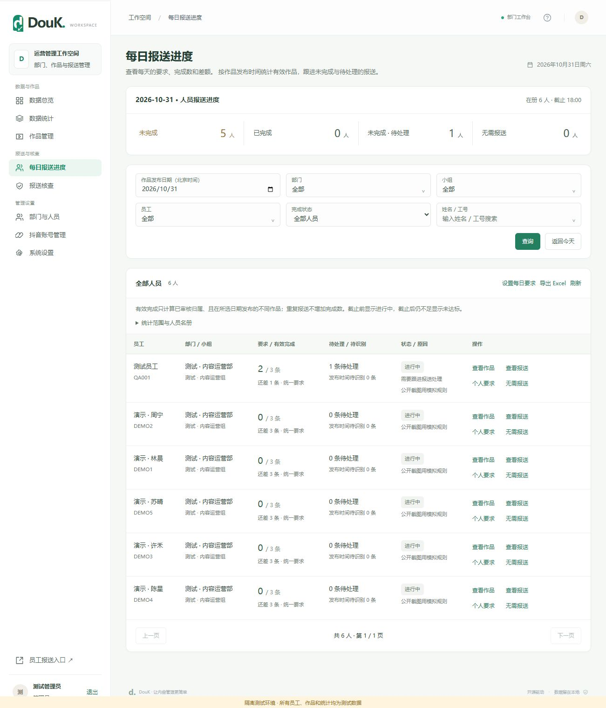
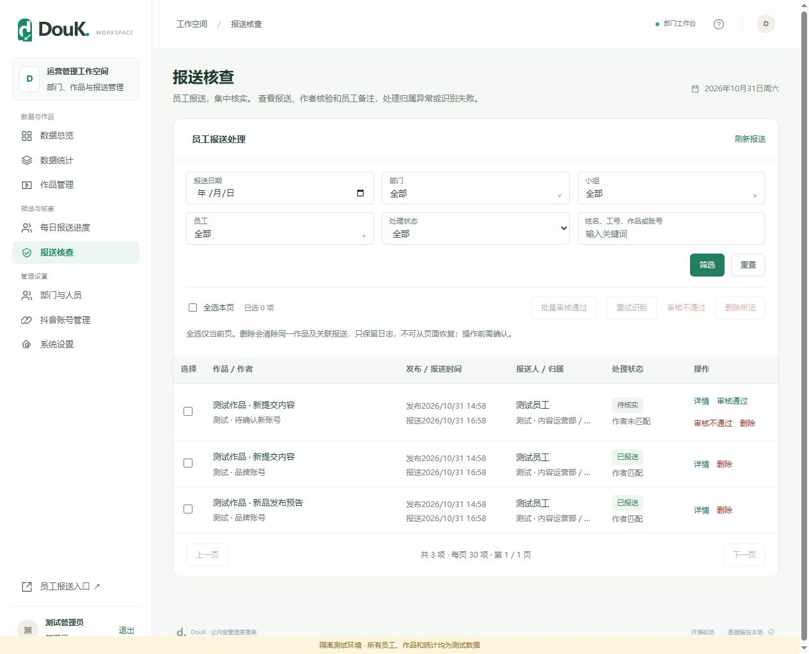

<div align="center">
  
  <p><strong>面向部门团队的抖音作品报送与运营管理工作台</strong></p>
  <p>Employee reporting · Account verification · Daily progress · Local-first data</p>
  <p>
    
    
    
    <a href="LICENSE"></a>
  </p>
  <p><a href="#快速开始">快速开始</a> · <a href="#界面预览">界面预览</a> · <a href="DouK-Web/docs/usage.md">操作说明</a> · <a href="DouK-Web/docs/developer.md">开发与部署</a> · <a href="DouK-Web/docs/verification.md">验证记录</a></p>
</div>

## 为什么做 DouK

部门里每个人都在发布内容，链接却散落在群聊里：谁完成了今天的要求？一条作品属于哪个账号、哪位员工？哪些报送还需要核实？

DouK 把这些工作收拢到一个本地工作台。员工填写部门、小组和姓名，核验抖音账号后粘贴作品链接；管理员集中处理归属、查看每日差额、筛选作品并导出记录。无需为每位员工维护一套网站密码。

> **定位说明**：这是基于员工主动报送的运营管理系统。自动巡检已移除，不会自动发现员工未报送的全部抖音作品；“未完成报送”不等于“没有发布视频”。

## 界面预览

下列图片均来自本项目的隔离演示环境。员工、账号、作品和统计均为测试数据；截图中的核验结果为模拟，不代表真实平台验证成功。

### 01 · 管理总览：先看需要跟进的人和事

今日人员进度、待核实报送与作品概况分区展示。老板从首页进入具体人员或报送记录，减少在复杂页面中查找。



### 02 · 员工报送：填写信息，核验账号，粘贴链接

免网站注册，抖音核验必填；支持多个核验账号和一次最多 20 条作品链接。本浏览器保存私有回执，便于查看处理结果和补充备注。



<details>
<summary><strong>03 · 查看每日进度：要求、完成数、差额与待处理</strong></summary>

统一要求、个人常规要求和当日调整配合使用。按作品发布日期及责任人计算，作品 ID 去重；补交昨天的作品归入昨天。



</details>

<details>
<summary><strong>04 · 查看报送核查：匹配事实与审核结论分别保留</strong></summary>

作者匹配有效核验账号且状态允许时自动通过；不匹配进入人工核实。紧凑列表提供详情、员工备注和批量处理，全选仅作用于当前页。



</details>

## 核心能力

- **员工报送**：部门 / 小组 / 姓名、批量链接、私有回执、补充备注，无需员工网站密码。
- **多账号核验**：同一员工可核验多个账号，用稳定账号标识匹配作品作者；有效凭据支持复用。
- **每日进度**：统一与个人目标、生效日期、执行日、截止时间、单日调整和免报原因。
- **作品台账**：文案、作者、发布时间、归属与可获取的互动指标；缺失数据不伪装为 0。
- **审核与组织**：部门、人员、小组、责任账号、归属审核、删除确认；删除与停用分离。
- **筛选与导出**：组织、人员、账号、状态和时间筛选；Excel 导出筛选后的全部结果。
- **本地维护**：SQLite 数据、操作日志、每日业务库快照、部署与恢复说明。
- **独立工具**：既有下载/采集工具独立运行，和老板运营工作区及业务库分开。

## 一条报送如何完成

1. 员工填写本人信息，并完成至少一个抖音账号核验。
2. 网站接收链接并保留接收时间，后台尝试解析分享链接、读取作品详情。
3. 作者与有效核验账号一致且归属状态允许，自动形成有效报送；否则进入待核实或失败状态。
4. 管理员核对原作品、账号和备注，确认归属；系统按发布日期重新计算对应人员进度。
5. 作品、处理记录和操作日志存入本地 SQLite，可筛选、导出和备份。

账号一致只说明发布账号匹配，不能证明内容原创；员工免网站登录也不等于严格认证现实中的填报人身份。

## 快速开始

**目标环境：Windows 10/11、Python 3.12+、Node.js 18+、Google Chrome。** Chrome 用于抖音核验；首次安装需要联网。FFmpeg 仅为独立工具直播录制所需。

```powershell
git clone https://github.com/llser66/DouK.git
cd DouK\DouK-Web
.\install.ps1
.\start.ps1
```

也可以下载仓库 ZIP，完整解压后依次双击 `DouK-Web/安装环境.cmd` 和 `DouK-Web/启动工作台.cmd`。保留 `DouK-Web` 与 `TikTokDownloader` 相邻的目录结构。

- 管理员：`http://127.0.0.1:8877/admin`
- 员工报送：`http://127.0.0.1:8877/report`
- 帮助文档：`http://127.0.0.1:8877/help`
- 独立工具：`http://127.0.0.1:8879`，仅服务器本机使用。

首次启动自动建立管理员 `admin / 123456`；仅在没有管理员且用户名可用时创建，重启不会重置已有密码。**这是初始弱口令，正式使用前请由维护人员更换；当前没有强制首次改密流程。不要将本版本直接暴露到公网。**

局域网部署由管理员 PowerShell 运行 `setup-lan.ps1 -InterfaceAlias '实际网卡名称'`。员工使用服务器的局域网 IP，不使用 `127.0.0.1`。服务器需保持开机、后台运行且不休眠。默认自启动是 Windows 用户登录时启动，不是无人登录的系统服务。

部署详情、连接检查和备份恢复见 [开发与部署文档](DouK-Web/docs/developer.md)。

## 技术结构

```text
DouK/
├─ DouK-Web/                 自研业务系统与独立前端
│  ├─ server.py              HTTP 服务、路由与上游适配入口
│  ├─ public_reports.py      报送、回执、审核与名册
│  ├─ report_accounts.py     核验凭据与账号匹配
│  ├─ daily_report_targets.py 每日目标与生效规则
│  ├─ report_progress.py     人员进度与差额
│  ├─ reports.*              员工页面
│  ├─ operations.py          作品、账号、统计与后台任务
│  ├─ workspace_backups.py   SQLite 一致性快照
│  ├─ tests/                 隔离业务与页面测试
│  └─ docs/                  操作 / 部署 / 验证文档
├─ TikTokDownloader/         上游源码快照，保留原始许可
├─ docs/images/              图文介绍与演示截图
└─ .github/                  CI、问题模板与协作规范
```

原生 HTML/CSS/JavaScript 前端，无需打包构建。业务后端主要使用 Python 标准库与 SQLite；平台能力由独立的 TikTokDownloader API 适配提供。业务 8877、独立工具 8879、上游 API 5555 分开运行。

## 验证与贡献

```powershell
cd DouK-Web
python -m unittest discover -s tests -p 'test_*.py' -v
python build_docs.py
node --check reporting-admin.js
```

离线测试使用临时数据库和模拟平台，覆盖报送、核验、权限、每日规则、删除、导出及备份；不代表真实抖音接口始终可用。仓库 CI 运行 Windows 上的离线回归，实际结果以 Actions 为准。详见 [验证记录](DouK-Web/docs/verification.md)。

欢迎提出可复现的问题和有边界的改进。提交前阅读 [贡献指南](CONTRIBUTING.md)；涉及凭据、权限或数据泄露的问题按 [安全说明](SECURITY.md) 私下反馈，不要在公开 Issue 粘贴 Cookie、数据库或员工资料。

## 能力边界与上游致谢

本项目由 [llser66](https://github.com/llser66) 维护。感谢 [JoeanAmier/TikTokDownloader](https://github.com/JoeanAmier/TikTokDownloader) 提供已有的平台读取能力。

- 当前运营报送使用上游既有的 `/douyin/share`、`/douyin/detail`；网站自身实现组织、报送、审核、每日目标与统计。
- 上游声明加密参数算法不再维护，原 Web UI 尚未重新开放；DouK 使用独立页面，**不保证平台更新后采集仍可用，也不承诺可用期限**。
- 核验失效会阻止新报送；详情识别失败会影响审核和有效完成数。当前尚未提供完整的“平台不可用时免核验报送”流程。
- 仅使用获得授权的账号和数据，遵守平台规则和适用法律；开源许可不等于取得平台数据使用授权。
- `data/`、Cookie、员工数据、浏览器资料、媒体和本机备份均不在仓库内。

## 许可证

按 [GNU GPL v3](LICENSE) 提供本项目代码。上游原始版权、许可和来源保留在 `TikTokDownloader/` 中；新增业务与适配代码的说明见 [第三方与修改记录](THIRD_PARTY_NOTICES.md)。分发时请保留许可、版权、修改说明和相应完整源码。
